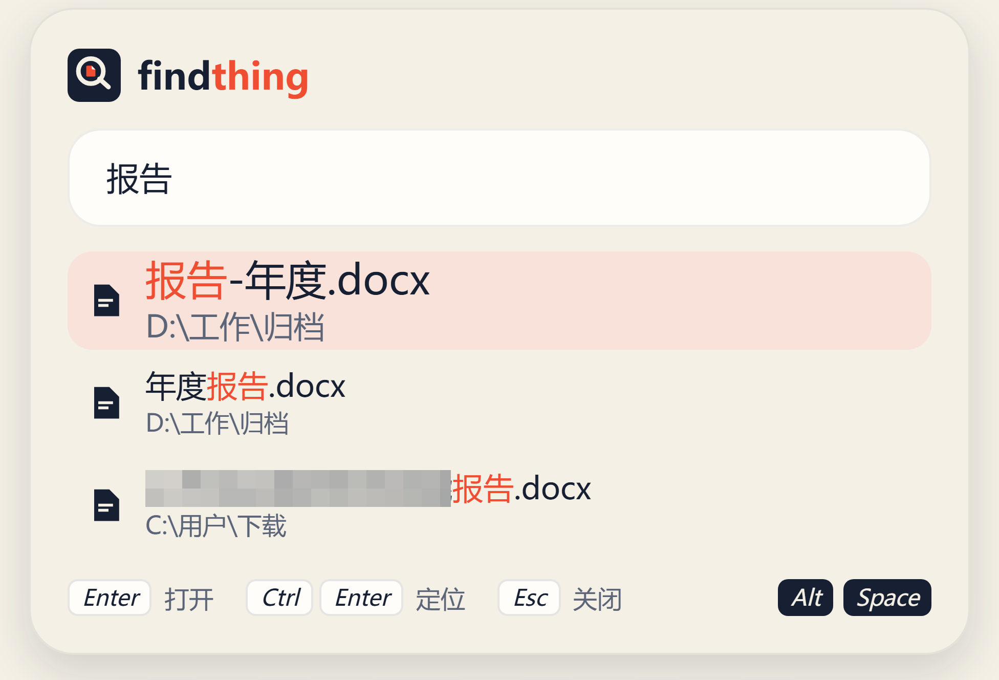
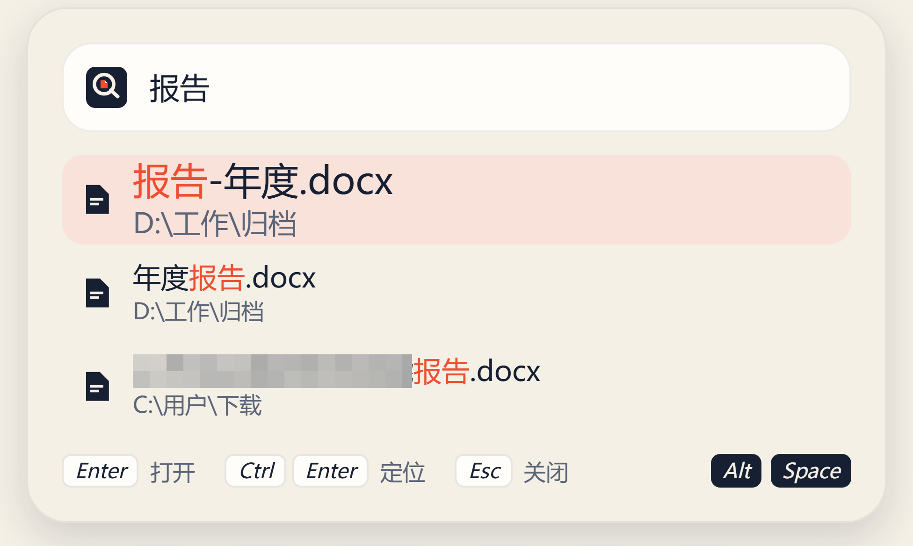
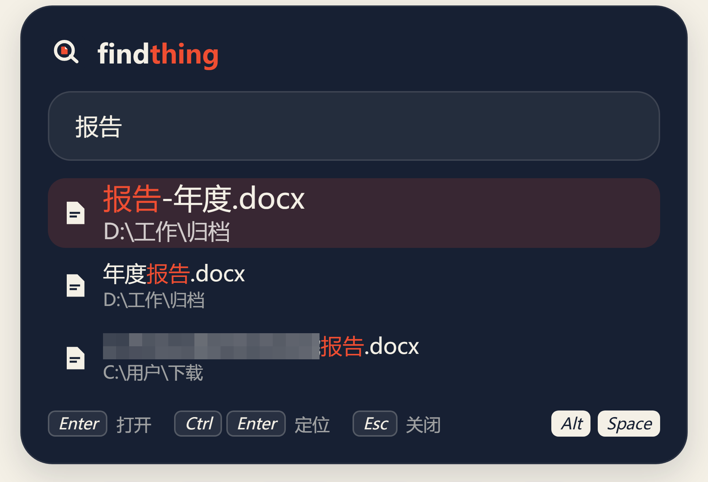
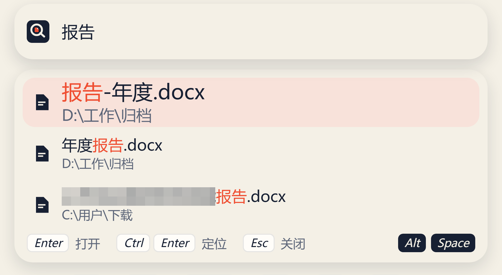
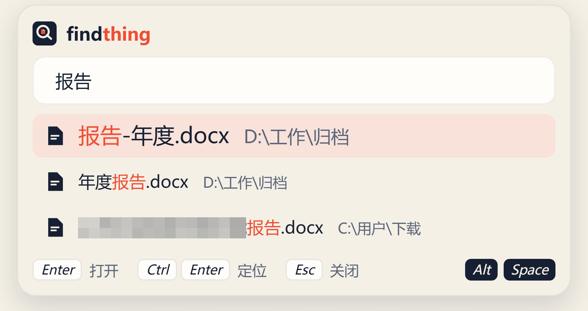

# findthing

Windows 上的轻量文件搜索：文件名即时检索、文件夹内定位、另存/打开对话框里挂搜索条，以及常用命令引导。

<p align="center">
  
</p>

## 要求

- Windows 10 / 11（x64）
- [Rust](https://rustup.rs/)（开发时）

## 运行

```bat
cargo run --release --bin findthing
```

托盘里选 Quit 干净退出。启动后会有两个 `findthing.exe`（守护进程 + `--app` 子进程）。

## 使用

- 默认热键：双击 Ctrl（可在程序里改）
- 输入文件名即时出结果
- 在「另存为 / 打开」对话框底部会出现搜索条，用来跳转目录
- 托盘可切换外观主题

## 外观

托盘菜单「窗口外观」里切换，马上生效。

| 素纸 | 轻条 |
| :---: | :---: |
|  |  |

| 夜墨 | 双笺 |
| :---: | :---: |
|  |  |

| 细目 |
| :---: |
|  |

- **素纸**：暖白窗口，上方有 findthing 标题
- **轻条**：去掉标题，图标放在搜索框里
- **夜墨**：深色窗口
- **双笺**：搜索框和结果分成两张纸
- **细目**：文件名和路径排在同一行

## 开源协议

MIT。详见 [LICENSE](LICENSE)。
